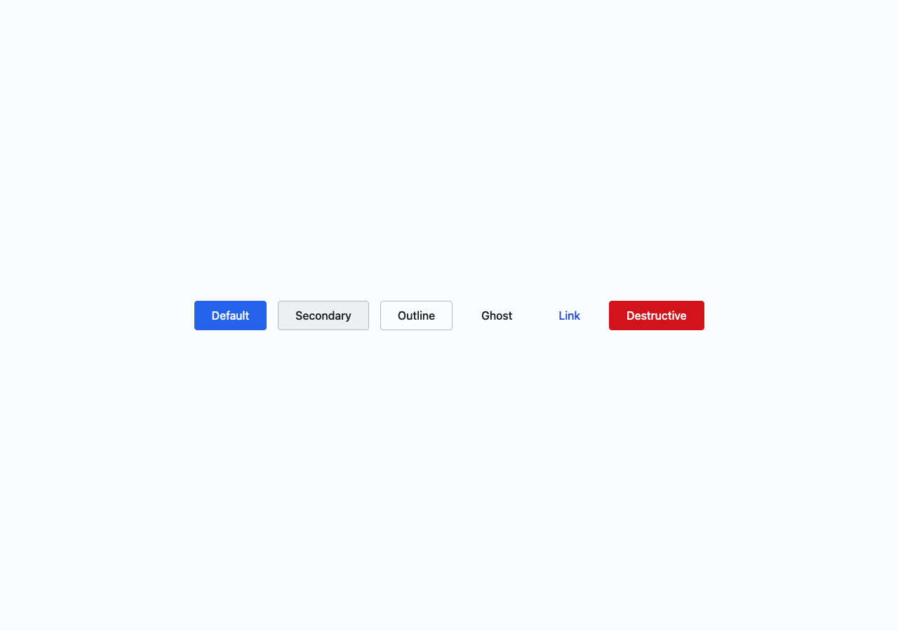
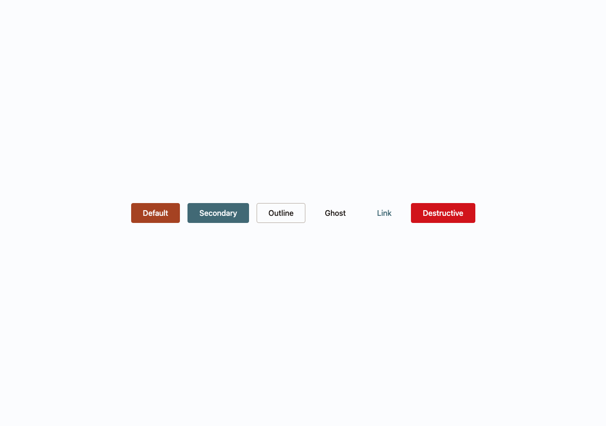

# Changing the brand color in Figma, and everything that had to follow

**Origin:** Figma/design decision — started from a change in the design file
**Status:** Draft — the Figma-side screenshots (see "Proof it works") are still
to add

> Wylie Dog is a design system: a shared library of colors, spacing and
> components that keeps a product's design file and its code in sync. It is
> built on **design tokens** — named values like "the main action color" that
> both Figma and the codebase read from one source, so a designer and an
> engineer are always looking at the same thing. A token can point at another
> token, in three tiers: **primitives** are raw values (a specific coral),
> **semantic** tokens give them a meaning ("primary action fill"), and
> **component** tokens say which meaning a part of a component uses ("the
> button's fill"). **Token Bridge** is a custom Figma plugin built for this
> project that moves token changes between Figma and GitHub. **Contrast** is
> how readable text is on its background, measured as a ratio; the web
> accessibility standard (WCAG 2.2, level AA) asks for at least 4.5 to 1 for
> normal text.

## The problem

A design system makes one big promise: change a few tokens and everything
that uses them changes with it, consistently, with nothing to hunt down by
hand. Wylie Dog had never actually tested that promise end to end. Its main
action color, primary, was blue, while the brand — taken from the project's
dog mascot — is a warm coral, with slate, sand and bark colors around it.
The brand colors existed in the system as raw values and nothing used them.
If the promise was true, swapping blue for coral should be a small change in
the design file. If it was only mostly true, the places where it broke would
be the places the system could not be trusted.

## How it surfaced

By design. The color change was chosen on purpose as the test. Before
touching anything, the starting state was captured (see `before/`): the six
semantic tokens that carry the primary role, how far they reach (117 lines of
the component token file and 25 source files), ten screenshots across
Storybook and the public site in Light and Dark, and the numbers from the
automated contrast check (145 text-on-background pairs declared, 0 failures).
The baseline also made a prediction: coral at the same brightness as the old
blue, with white text, measures 3.98 to 1 — below the 4.5 minimum — so a
straight swap should fail, and the fix would be a design decision, not a code
edit.

## The investigation

**The swap itself was tiny.** In Figma, three variables changed: the primary
fill, the primary border and the hover shade, each from a blue step to the
matching coral step. Pulled into code, those three re-themed the button, the
badge and every component token pointing at them (18 of them) with no code
edited. For the happy path the promise held.

**Storybook still showed blue.** The first check after the pull looked like
nothing had happened. The token files on disk were right: the built CSS
contained coral and no blue. The cause was a Storybook development server that
had been running for two days and kept serving the stylesheet it had loaded
then. A restart fixed it. Chasing it exposed a second, quieter problem: every
local build rewrote the synced token files with their keys in a different
order from the order the plugin writes them. Nothing about the tokens changed,
but git saw two modified files, and the next push from Figma collided with
them as a merge conflict. The build now writes the plugin's order, so a local
build no longer touches files the plugin owns.

**A second edit made button text invisible, and a check caught it before any
screenshot.** To keep links readable on the new color, the Figma file reused
the token meaning "text on a primary fill" as the link color. Components
also use that token for button text, so button text became coral on a coral
button: a contrast ratio of 1.00 to 1. The automated contrast check reported
39 failures (it had reported 31 right after the first pull, from the coral
fill being too light for white text). Nobody had to look at a screen to know
something was wrong. The root cause was that one token was doing three jobs:
text on the fill, primary-colored emphasis text (about 68 uses in the
showcase) and links. The fix was to give links their own token instead of
overloading a neighbour, which is also how design systems like IBM's Carbon
and GitHub's Primer handle it. The link color is slate rather than coral on
purpose: coral and the error red sit at nearly the same hue, so color-only
links and error text would have been hard to tell apart.

**The public site still described primary as blue.** The showcase pages carried
typed copies of the old colors: the tier explanation named a blue step by
hand, the swatches and ramps were blue, avatars and window dots used raw
color steps, and the code-window mock-ups had a fixed palette. Counted, that
was 164 hard-coded references in the pages. Each was a copy a token change
could not reach. They now read from the real tokens, the mock-ups are
dark-themed islands that use semantic tokens, and a new check fails the build
if a showcase page hard-codes a palette color again (it was run against a
deliberately bad file to prove it fails).

**Passing the contrast check did not mean the buttons were readable.** The
first version of the fix put dark text on the coral fill because that scored
best on the standard's maths: 4.83 to 1. It looked weak. The newer APCA model,
proposed for the next version of the web accessibility standard, explains
why: the standard's formula overrates dark text on mid-tone saturated colors.

| Fill and text                               | WCAG 2 ratio    | APCA score |
| ------------------------------------------- | --------------- | ---------- |
| Coral (step 600), dark text                 | 4.83 (passes)   | 37         |
| Coral (step 600), white text                | 3.98 (fails AA) | 71         |
| Coral (step 700), white text                | 6.02 (passes)   | 83         |
| Slate secondary, dark text                  | 4.74 (passes)   | 35         |
| Slate secondary one step darker, white text | 5.84 (passes)   | 83         |

APCA wants roughly 60 or more for body-size text. The project's gate is still
WCAG 2.2 AA, so white on the original coral cannot ship; but a darker step
passes both models. That darker coral is also the second shade in the logo.

## The fix

The changes, grouped by what they solve:

- **Links get their own token** (`foreground.link`, slate), so primary can
  mean one thing: the fill's text and the action color.
- **One rule for solid fills:** white text on every filled color except
  warning (yellow, a light fill), and hover and pressed always go darker. The
  main action is the darker coral step; the secondary is the matching slate
  step. One value serves both Light and Dark. A lighter dark-mode step would
  force dark text again, and the readability gain would be lost.
- **A pressed state for every role,** through a new tone named `intense`, one
  step past `emphasis`. Before, pressed and hover were the same color where a
  pressed token existed at all. Semantic names still carry no state word.
- **The brand colors take the neutral ground:** warm sand surfaces and
  stone borders in Light, near-black bark surfaces and sand text in Dark, with
  the contrast check passing unchanged.
- **Three roles in the slate color with separate jobs:** secondary (the
  Secondary button and badge), accent (selected controls such as checkboxes,
  switches and tabs) and info (new Info variants of Alert and Toast). They
  resolve to the same color today and can each be recolored on their own.
- **The tooltip surface** moved to slate.
- **The showcase was fixed at the root** (read from tokens, guarded), and the
  tooling bug (the key order) was fixed.

Alternatives that were weighed and turned down: using coral for links
(too close to error red), a slate focus ring (it fails against a coral
button in Dark mode without the white halo gap), and retiring the Info role
because nothing used it (a design system's tokens are a standard for its
consumers, so the role was wired in instead).

## Proof it works

_Before and after, same method, same viewport (1280 by 900), in `before/` and
`after/`._

Storybook, the six button variants, Light:

|                                                       | Before                                                | After                                               |
| ----------------------------------------------------- | ----------------------------------------------------- | --------------------------------------------------- |
| Default, Secondary, Outline, Ghost, Link, Destructive |  |  |

The home page, the components page and the token colors page, in both modes,
are in the same two folders (`showcase-home-*`, `showcase-components-*`,
`showcase-tokens-colors-*`, `storybook-badge-*`).

Measured:

| Check                                                                | Before            | During the edits     | After           |
| -------------------------------------------------------------------- | ----------------- | -------------------- | --------------- |
| Contrast check (declared text and boundary pairs)                    | 0 failures of 404 | 31, then 39 failures | 0 of 466        |
| Storybook tests, including automated accessibility in Light and Dark | passing           | —                    | 860 of 860 pass |
| Hard-coded palette colors in the public site's pages                 | 164               | —                    | 0, and guarded  |

_TODO (needs Figma, from Travis):_ the primary variables in the design file
before and after, and the Token Bridge Pull preview showing the changed and
added variables, to close the loop that the color was changed in Figma and
arrived in code.

## Why this matters

The test did not fail, and that is the useful part. The swap really was three
variables. What it exposed was everything that quietly depended on the old
color without being a token: a neighbouring token stretched to cover a
second meaning, documentation pages that described the old color by hand, a
build step that fought the plugin over file order, and a contrast score that
said "fine" about buttons that looked weak.

Four things fall out of that. Each token has to mean one thing, or changing it
changes something else. Anything that shows or explains a token, including the
site that documents the system, has to read it and not copy it, with a check
that fails when it does not. A check that stops the build teaches more than a
review that depends on someone noticing. And contrast needs two lenses: the
standard everyone is held to, and a perceptual model that catches what the
standard misses.

The color change that started this is now the smallest part of the change.
That is what a design system's promise costs in practice, and what it buys:
the next brand change should be the three variables and nothing else.

---

_Screenshots and other artifacts for this case study live in `before/` and
`after/` subfolders next to this file._
